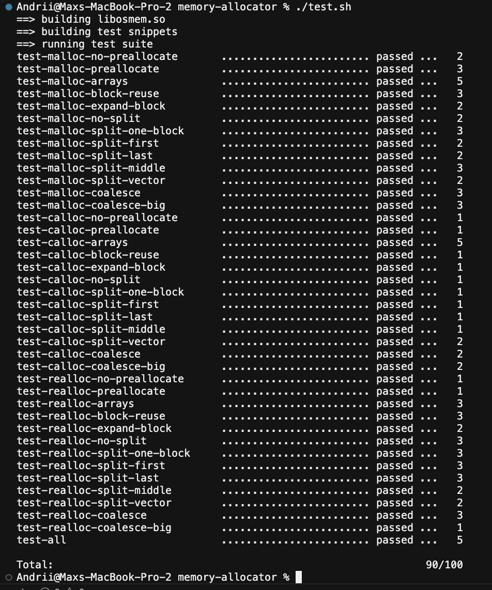

# Memory allocator

Реалізація `os_malloc`, `os_calloc`, `os_realloc` та `os_free`
через `brk()` / `mmap()` за завданням
[open-education-hub/memory-allocator](https://github.com/open-education-hub/operating-systems/tree/main/content/assignments/memory-allocator).

При виконанні лабораторної роботи використовувалась модель Claude Opus 4.7 (Anthropic).

Код розбитий на три translation units:

| Файл | Що робить |
|---|---|
| `src/osmem.c` | публічний API, диспетчеризація запитів |
| `src/blocks.c` | списки блоків, `best_fit`, `split`, `coalesce` |
| `src/heap.c` | обгортки навколо `sbrk`/`mmap` і передалокація 128 КіБ |
| `src/internal.h` | спільні константи та прототипи |

## Запуск

Швидко — одна команда (під macOS сама підніме Docker-образ, під
Linux просто викличе `make`):

```sh
./test.sh
```

Або вручну. Потрібен Linux (або WSL) з `gcc`, `make`, `python3`,
`ltrace` та `valgrind`:

```sh
sudo apt install build-essential python-is-python3 ltrace valgrind
```

Збірка бібліотеки:

```sh
cd src
make
```

Запуск усіх тестів:

```sh
cd tests
make check          # з valgrind
make check-fast     # швидкий, без valgrind
```

Окремий тест:

```sh
cd tests
python run_tests.py -d test-all
```

## Запуск через Docker

Якщо нема під рукою Linux, у репо є [`Dockerfile`](Dockerfile):

```sh
docker build -t osmem .
docker run --rm -v "$(pwd)":/work osmem bash -c '
    cd src && make &&
    cd ../tests && make check-fast'
```

## Результати


